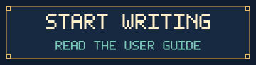
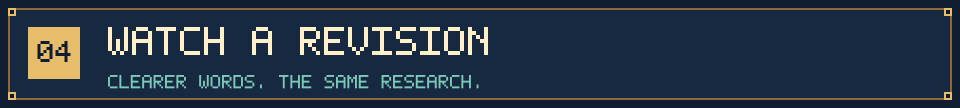

<p align="center">
  
</p>
<p align="center">
  
</p>

<h1 align="center">From a first paragraph to a clearer paper.</h1>

<p align="center">
  An academic writing mentor skill for first-time writers and authors with a draft.<br />
  Bring your manuscript, notes, or references. Get editing informed by your field, target journal, and immediate task, with the reasons explained.
</p>

<p align="center">
  <a href="docs/guide.en.md"></a>
  &nbsp;
  <a href="https://github.com/NoNightWatch/EZ-to-write-a-paper/releases/latest"></a>
</p>
<p align="center">
  <a href="docs/guide.en.md">English guide</a> ·
  <a href="README.md">中文</a> ·
  <a href="docs/guide.zh-CN.md">中文指南</a> ·
  <a href="academic-manuscript-polish/SKILL.md">Skill entry</a> ·
  <a href="#quick-start">Quick start</a>
</p>
<p align="center"><strong>Codex · Claude Code · AI assistants with local file access</strong><br /><sub>v3.2.0 · Self-contained bundle · Chinese and English user guides · Teaching resources primarily in Chinese</sub></p>


<sub>The 2,080 records include terms repeated across fields, with 2,043 distinct English headwords by literal deduplication. Domain entries provide foundation coverage. Journal cards have dated, limited verification; check current requirements before submitting.</sub>


## Where are you stuck?

<table>
<tr>
<td width="50%" valign="top">

<h3>You know what you mean, but cannot get it onto the page</h3>
<p>Start with notes, loose sentences, or one paragraph. Receive a usable revision and an explanation of the most important changes. If you want practice, work through one small writing task with the mentor.</p>
<p><a href="academic-manuscript-polish/references/beginner-guide.md">Beginner entry</a> · <a href="academic-manuscript-polish/references/mentor-lessons.md">Nine short lessons</a></p>
</td>
<td width="50%" valign="top">

<h3>You have read the papers, but your review is a list of summaries</h3>
<p>Compare sources around a specific question. Organize similarities, differences, and scope into a connected paragraph. First distinguish an introduction paragraph, a thesis chapter, and a standalone review; then choose the appropriate workflow.</p>
<p><a href="academic-manuscript-polish/references/literature-review-mentor.md">Review mentor</a> · <a href="academic-manuscript-polish/references/review-worked-example.md">Worked review exercise</a></p>
</td>
</tr>
</table>

| Your task | What to ask | What you receive |
| :--- | :--- | :--- |
| Polish an existing draft | “Keep the content; improve grammar, wording, and transitions.” | Revised text and necessary questions |
| Organize a section | “Help me order this section and explain the changes.” | Structure and revisions based on supplied material |
| Check cross-field terminology | “Check terms and abbreviations for consistency.” | Terminology checks in context |
| Prepare for a target journal | “Check this section against the journal's current author guidelines.” | Verified requirements, edits, and unresolved items |
| Learn to revise independently | “Show me one revision, then offer a short exercise.” | Editing, explanation, and an optional practice answer |

Switch between “just give me the revision” and “explain in more detail” whenever you want. You do not need to learn a writing taxonomy or complete a form before starting.

<a id="quick-start"></a>


## Start in three steps

### 1. Download the complete folder

Download the skill ZIP from [Releases](https://github.com/NoNightWatch/EZ-to-write-a-paper/releases/latest) and extract it. Keep the complete `academic-manuscript-polish/` folder, including `SKILL.md`, `references/`, `assets/`, and the remaining files. You can also download the entire repository with GitHub's **Code → Download ZIP**.

### 2. Put it where your assistant can read it

| Environment | Project installation path |
| :--- | :--- |
| Codex | `<your-project>/.agents/skills/academic-manuscript-polish/` |
| Claude Code | `<your-project>/.claude/skills/academic-manuscript-polish/` |
| Another file-reading assistant | Keep the directory intact and ask it to read `SKILL.md` and the relative references it needs |

Availability depends on your host and organization settings. [Installation and troubleshooting](docs/guide.en.md#install) covers user-level locations and checks. Paths follow the official [OpenAI](https://learn.chatgpt.com/docs/build-skills) and [Claude Code](https://code.claude.com/docs/en/skills) documentation.

### 3. Bring a real piece of writing

```text
Please use academic-manuscript-polish.

Material: my draft / notes / outline below.
Target journal: [journal name, or undecided].
Scope for this session: [one sentence / paragraph / section / full draft].
Output language: English.

Give me a usable revision first, then explain the two or three
most important changes. Preserve numbers, citations, and meaning.
Ask me when a technical point needs clarification.
[Paste your material or provide an accessible file.]
```

After installation, you can invoke `$academic-manuscript-polish` in Codex or `/academic-manuscript-polish` in Claude Code. Start with one paragraph to check that the editing level suits you, then expand the scope.


## Open the writing library

| Resource | Contents and entry point |
| :--- | :--- |
| **Fields and terminology** | [52 entries](academic-manuscript-polish/references/discipline-map.md) across natural sciences, engineering and technology, medicine and health, agricultural sciences, social sciences, humanities and arts, plus general writing and research reporting |
| **Terminology in depth** | [Foundation glossary](academic-manuscript-polish/references/foundation-index.md) and [nine detailed glossaries](academic-manuscript-polish/references/glossary-index.md); the detailed set has 308 entries with usage and boundaries |
| **Article organization** | [Ten writing paths](academic-manuscript-polish/references/writing-framework.md) covering how to enter an introduction, order the body, and organize explanations already supplied by the author |
| **Section-level writing** | [Section handbook](academic-manuscript-polish/references/section-handbook.md), [English language toolkit](academic-manuscript-polish/references/language-toolkit.md), and 12 [worked revisions](academic-manuscript-polish/references/worked-examples.md) |
| **Learning through editing** | [Nine lessons](academic-manuscript-polish/references/mentor-lessons.md), [six mentor dialogues](academic-manuscript-polish/references/mentor-dialogues.md), and [52 domain exercises](academic-manuscript-polish/references/domain-practice.md) |
| **Literature reviews** | [Reading and synthesis workflow](academic-manuscript-polish/references/literature-review-mentor.md), a [worked exercise](academic-manuscript-polish/references/review-worked-example.md), and [four cross-disciplinary exercises](academic-manuscript-polish/references/review-transfer-cases.md) |
| **Journal adaptation** | [15 journal cards](academic-manuscript-polish/references/journal-cards.md) and an [adaptation workflow](academic-manuscript-polish/references/journal-adaptation.md), distinguishing publisher requirements, observations from sample articles, and unverified points |
| **A field that is not covered** | Use the [author-supplied literature workflow](academic-manuscript-polish/references/author-literature.md) to build a manuscript-specific terminology and genre reference |

Foundation definitions are short working glosses, without entry-by-entry external expert verification. Detailed and foundation entries overlap. The assistant should load resources relevant to the current draft and check formal definitions against original sources or standards.

<details>
<summary><strong>Explore the ten writing paths</strong></summary>

| Path | Writing task |
| :--- | :--- |
| A · Concepts, models, and formal proof | Introduce objects, definitions, and dependencies in a derivation |
| B · Process description | Organize existing material by stages, locations, or time |
| C · Comparative studies | Present comparable objects using shared measures |
| D · Question-by-question response | Align questions, findings, and discussion |
| E · Conditions and time | Move from overall findings to stages or conditions |
| F · Mapping and prediction reports | Describe coverage, tasks, and the manuscript's existing metrics |
| G · Methods and tools | Connect a concrete user task to existing performance evidence |
| H · Definitions and measurement | Distinguish concepts, indicators, and their relationships |
| I · Historical, textual, and contextual narrative | Develop chronology, themes, or source units |
| J · Literature synthesis | Organize several sources by questions and comparison dimensions |

Paths can be combined. They support textual organization; technical theory and research design require the author's material.

</details>



## Understand what changed

This is a fictional teaching example, not research evidence.

**Material from the author**

> We interviewed 18 students. In the interviews, 12 said feedback came too late. We want to describe their views about feedback timing.

**Example revision**

> We interviewed 18 students about their perceptions of feedback timing. Twelve participants reported that feedback arrived too late.

**The mentor's explanation**

1. The first sentence establishes participants, sample size, and topic.
2. `Reported` makes clear that the second sentence describes participants' accounts.
3. Both numbers remain unchanged. No claim about grades has been added because the material provides no such finding.

**Optional next step**: supply the actual interview time window, then decide whether it belongs in the methods paragraph. You can also move straight to the next paragraph.


## A clear scope for each revision

| Stage | What the assistant does | What you can inspect |
| :--- | :--- | :--- |
| Read | Establish accessible material and the current task | What was read and what was inaccessible |
| Route | Select relevant terms, section guidance, and journal requirements | Sources used and requirements awaiting verification |
| Revise | Edit language or organization within the agreed scope | Correspondence between the original and revised text |
| Explain | Discuss important changes, with optional practice | Why a change helps and what it preserves |
| Check | Review numbers, units, citations, terms, and visible formatting | Completed work and remaining author decisions |

Review tasks also record the actual reading scope and check source support for each claim before assembling a synthesis. Long drafts can be handled in batches. A progress card can support a later session; saving one requires the author's request.


## Before you set out

<details>
<summary><strong>Can I start without a complete draft or target journal?</strong></summary>

Yes. Bring existing notes, an outline, or a paragraph. If the journal is undecided, start with general editing. With only a topic and no substantive material, the assistant can help frame questions and a materials checklist; it should not generate research facts.

</details>

<details>
<summary><strong>What if my field is missing?</strong></summary>

Provide relevant papers or definitions and explain what you want to learn from them. The assistant records their provenance and scope and builds a reference for your manuscript. A handful of sample papers cannot establish conventions for an entire field or journal.

</details>

<details>
<summary><strong>Can it help write a literature review?</strong></summary>

Yes, using materials you actually provide: comparison, organization, and wording. Abstract-only access is labelled. A collection that has not undergone the required search, screening, and methods process should not be called a systematic review. See the [review guide](docs/guide.en.md#review).

</details>

<details>
<summary><strong>Is the whole bundle bilingual?</strong></summary>

The homepage and user guide have full Chinese and English versions. Terms include Chinese-English equivalents. Teaching resources and most internal instructions are primarily in Chinese. Ask your assistant for English revisions and explanations; this repository does not claim a page-by-page English translation of every resource.

</details>

<details>
<summary><strong>Do I need Python? Can I use it offline?</strong></summary>

Reading the resources and following the editing workflow do not require scripts. Optional offline lookup and validation need Python 3.9+ and use only its standard library. Network access and manuscript processing depend on your AI host and account settings. A locally stored skill does not mean the model runs locally.

</details>

<details>
<summary><strong>Will it upload my draft, submit it, or change my original file automatically?</strong></summary>

The instructions require preserving the original and prohibit publication, submission, or adding manuscript content to the shared bundle without an explicit request. Check host permissions, institutional confidentiality requirements, and the journal's AI policy before supplying unpublished material. Do not post private manuscripts in this repository's public Issues.

</details>

**Writing boundaries**: preserve author-supplied facts and research judgments. Do not fabricate data, citations, mechanisms, or ethics information. Acceptance is not guaranteed. Claims about journal preferences require sources; current official author guidelines take priority. Medical content is for reading and academic expression; the bundle does not supply hazardous operational details.

**Verification scope**: v3.2.0 underwent five rounds of self-review and repair, with 38 passing structure and search tests. These tests do not run language models or establish teaching effectiveness or the correctness of every technical definition. See the [check record](academic-manuscript-polish/tests/release-checks.md) and [source record](academic-manuscript-polish/references/sources.md).

<details>
<summary><strong>Folder structure and optional local commands</strong></summary>

```text
academic-manuscript-polish/
  SKILL.md               Skill entry
  references/            Terminology, lessons, journals, writing resources
  assets/                Optional task cards and delivery templates
  agents/                Host display metadata
  scripts/               Term lookup and structural validation
  tests/                 Automated tests and check records
  bundle-manifest.json   Version and content inventory
```

Run from inside the skill folder:

```sh
python scripts/search_terms.py "validity" --exact
python scripts/search_terms.py --list-domains
python scripts/validate_bundle.py
python -B tests/test_bundle.py
```

</details>

<p align="center"></p>
<p align="center"><strong>Bring one paragraph. Choose one small goal. Begin.</strong></p>
<p align="center"><a href="docs/guide.en.md">Read the English guide</a> · <a href="docs/guide.zh-CN.md">阅读中文指南</a> · <a href="https://github.com/NoNightWatch/EZ-to-write-a-paper/releases/latest">Download the skill</a></p>
<p align="center"><sub>Find it useful? Star the repository to keep it handy. Report problems in an <a href="https://github.com/NoNightWatch/EZ-to-write-a-paper/issues">Issue</a> without including private manuscript content.</sub></p>
