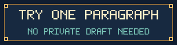
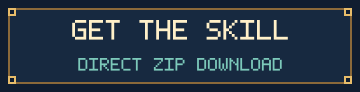
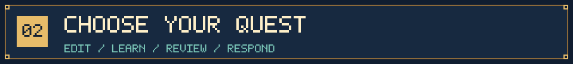
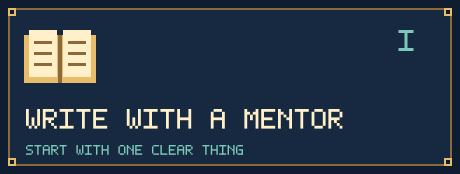
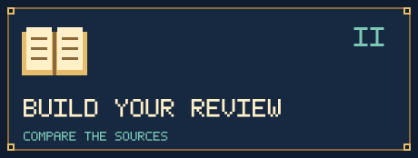
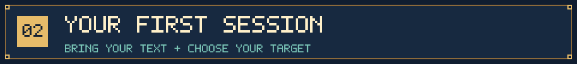
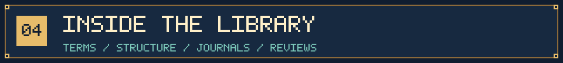
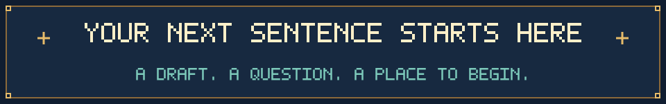

<p align="center">
  
</p>
<h1 align="center">Bring a draft. Start with one clearer paragraph.</h1>

<p align="center">
  PAPER QUEST · An academic writing guide<br />
  Revise drafts, understand edits, organize sources, and respond to reviewers. You choose the editing scope and learning pace.
</p>

<p align="center">
  <a href="#try-demo"></a>
  &nbsp;
  <a href="https://github.com/NoNightWatch/EZ-to-write-a-paper/releases/latest/download/academic-manuscript-polish.zip"></a>
</p>
<p align="center">
  <a href="docs/guide.en.md">English guide</a> ·
  <a href="README.md">中文</a> ·
  <a href="docs/guide.zh-CN.md">中文指南</a> ·
  <a href="academic-manuscript-polish/SKILL.md">Workflow guide</a> ·
  <a href="#quick-start">Quick start</a>
</p>
<p align="center"><strong>Codex · Claude Code · AI assistants with local file access</strong><br /><sub>v3.4.1 · Start through file access · Chinese and English start pages included · Teaching resources primarily in Chinese</sub></p>

<a id="try-demo"></a>


## See what you would receive

This original fictional example contains no real research data. Read it first, then download the bundle and have your assistant use the [demo request](academic-manuscript-polish/assets/first-session-demo.md).

**Your paragraph**

> We interviewed 18 students about feedback timing. 12 of them said it was too late. We wanted to know their views.

**One usable revision**

> We interviewed 18 students about their views on feedback timing. Twelve participants reported that the feedback arrived too late.

**The explanation**: combine the repeated purpose; clarify that `it` refers to feedback; preserve 18, 12, and the attribution to participants. Add no claim about grades.

Then try: “Restore the original first sentence and keep the revised second sentence. Explain in English.” This is a reference example; actual model wording may differ. [Try through file access](docs/guide.en.md#try-without-install) · [Install step by step](docs/guide.en.md#install)



## Where are you stuck?

<table>
<tr>
<td width="50%" valign="top">

<h3>You know what you mean, but cannot get it onto the page</h3>
<p>Start with notes, loose sentences, or one paragraph. Receive a usable revision and an explanation of the most important changes. If you want practice, work through one small writing task with the mentor.</p>
<p><a href="academic-manuscript-polish/references/beginner-guide.md">Beginner entry</a> · <a href="academic-manuscript-polish/references/mentor-lessons.md">Nine short lessons</a></p>
</td>
<td width="50%" valign="top">

<h3>You have read the papers, but your review is a list of summaries</h3>
<p>Compare sources around a specific question. Organize similarities, differences, and scope into a connected paragraph. First distinguish an introduction paragraph, a thesis chapter, and a standalone review; then choose the appropriate workflow.</p>
<p><a href="academic-manuscript-polish/references/literature-review-mentor.md">Review mentor</a> · <a href="academic-manuscript-polish/references/review-worked-example.md">Worked review exercise</a></p>
</td>
</tr>
</table>

| Your task | What to ask | What you receive |
| :--- | :--- | :--- |
| Polish an existing draft | “Keep the content; improve grammar, wording, and transitions.” | Revised text and necessary questions |
| Organize a section | “Help me order this section and explain the changes.” | Structure and revisions based on supplied material |
| Check cross-field terminology | “Check terms and abbreviations for consistency.” | Terminology checks in context |
| Prepare for a target journal | “Check this section against the journal's current author guidelines.” | Verified requirements, edits, and unresolved items |
| Learn to revise independently | “Show me one revision, then offer a short exercise.” | Editing, explanation, and an optional practice answer |
| Respond to reviewers | “Work through these comments against the current draft; separate completed and planned work.” | Response drafts, manuscript locations, and remaining work |

Switch between “just give me the revision” and “explain in more detail” whenever you want. You do not need to learn a writing taxonomy or complete a form before starting.

<a id="quick-start"></a>


## Three steps, without a long intake form

### 1. Download the complete folder

[Download the guide ZIP directly](https://github.com/NoNightWatch/EZ-to-write-a-paper/releases/latest/download/academic-manuscript-polish.zip) and extract it. Open `START-HERE.en.md` or `START-HERE.zh-CN.md` inside. Keep the complete folder. [Release history](https://github.com/NoNightWatch/EZ-to-write-a-paper/releases) provides earlier versions; GitHub's **Code → Download ZIP** downloads the entire repository instead.

### 2. Have your assistant read the start page

Place the complete folder in a workspace your assistant can read. Ask: “Read `academic-manuscript-polish/START-HERE.en.md`, follow its link to the workflow guide, and use the fictional demo. Do not change settings.” A chat interface that cannot read directories requires the relevant content separately.

Choose the reading method supported by your environment:

| Environment | How to begin |
| :--- | :--- |
| Codex or Claude Code | Open a session in the workspace containing the guide and provide the start page's actual location |
| Another file-reading assistant | Keep the directory intact and ask it to read the start page and its relative links |
| A chat interface with uploads or pasted text only | Supply the workflow guide, relevant resources, and draft excerpt; confirm what the assistant can read |

Availability depends on your host and organization settings. You can start without changing configuration. [Setup and troubleshooting](docs/guide.en.md#install) covers regular use.

### 3. Bring a real piece of writing

```text
Use academic-manuscript-polish to edit this paragraph.
Change only the language. Preserve numbers, citations, and meaning.
Revise and explain in English. Give the clean version first.
[Paste text.]
```

You can start without a target journal. Confirm that the assistant read the workflow guide and relevant resources before expanding the task. [Already have an older version?](docs/guide.en.md#update)



## Open the writing library


<sub>The 2,080 records include cross-field repetitions, with 2,043 distinct English headwords by literal deduplication. Counts describe coverage, not performance scores. See scope and verification limits below.</sub>

| Resource | Contents and entry point |
| :--- | :--- |
| **Fields and terminology** | [52 entries](academic-manuscript-polish/references/discipline-map.md) across natural sciences, engineering and technology, medicine and health, agricultural sciences, social sciences, humanities and arts, plus general writing and research reporting |
| **Terminology in depth** | [Foundation glossary](academic-manuscript-polish/references/foundation-index.md) and [nine detailed glossaries](academic-manuscript-polish/references/glossary-index.md); the detailed set has 308 entries with usage and boundaries |
| **Article organization** | [Ten writing paths](academic-manuscript-polish/references/writing-framework.md) covering how to enter an introduction, order the body, and organize explanations already supplied by the author |
| **Section-level writing** | [Section handbook](academic-manuscript-polish/references/section-handbook.md), [English language toolkit](academic-manuscript-polish/references/language-toolkit.md), and 12 [worked revisions](academic-manuscript-polish/references/worked-examples.md) |
| **Learning through editing** | [Nine lessons](academic-manuscript-polish/references/mentor-lessons.md), [six mentor dialogues](academic-manuscript-polish/references/mentor-dialogues.md), and [52 domain exercises](academic-manuscript-polish/references/domain-practice.md) |
| **Literature reviews** | [Reading and synthesis workflow](academic-manuscript-polish/references/literature-review-mentor.md), a [worked exercise](academic-manuscript-polish/references/review-worked-example.md), and [four cross-disciplinary exercises](academic-manuscript-polish/references/review-transfer-cases.md) |
| **Journal adaptation** | [15 journal cards](academic-manuscript-polish/references/journal-cards.md) and an [adaptation workflow](academic-manuscript-polish/references/journal-adaptation.md), distinguishing publisher requirements, observations from sample articles, and unverified points |
| **A field that is not covered** | Use the [author-supplied literature workflow](academic-manuscript-polish/references/author-literature.md) to build a manuscript-specific terminology and genre reference |
| **Revisions and editing controls** | [Point-by-point reviewer responses](academic-manuscript-polish/references/reviewer-response.md) and [session controls](academic-manuscript-polish/references/session-controls.md), preserving author decisions and manuscript correspondence |

Foundation definitions are short working glosses, without entry-by-entry external expert verification. Detailed and foundation entries overlap. The assistant should load resources relevant to the current draft and check formal definitions against original sources or standards.

<details>
<summary><strong>Explore the ten writing paths</strong></summary>

| Path | Writing task |
| :--- | :--- |
| A · Concepts, models, and formal proof | Introduce objects, definitions, and dependencies in a derivation |
| B · Process description | Organize existing material by stages, locations, or time |
| C · Comparative studies | Present comparable objects using shared measures |
| D · Question-by-question response | Align questions, findings, and discussion |
| E · Conditions and time | Move from overall findings to stages or conditions |
| F · Mapping and prediction reports | Describe coverage, tasks, and the manuscript's existing metrics |
| G · Methods and tools | Connect a concrete user task to existing performance evidence |
| H · Definitions and measurement | Distinguish concepts, indicators, and their relationships |
| I · Historical, textual, and contextual narrative | Develop chronology, themes, or source units |
| J · Literature synthesis | Organize several sources by questions and comparison dimensions |

Paths can be combined. They support textual organization; technical theory and research design require the author's material.

</details>


## Change direction or restore a sentence

| What you want | What to say |
| :--- | :--- |
| Understand the problems first | “Diagnose only. Do not edit files. Identify the two main obstacles to understanding.” |
| Preserve your voice | “Correct necessary grammar; keep my wording and paragraph order.” |
| Inspect changes | “Give a clean version first, followed by important before/after changes.” |
| Restore a local passage | “Restore the original second sentence and keep the other edits.” |
| Change the teaching pace | “Show me, then let me practise” or “Give me the answer directly.” |

Restoring text requires access to the original. Plain-text comparisons are not native Word tracked changes. The assistant distinguishes necessary corrections from optional style preferences.

**Fit your field. Keep your voice.** Use relevant published passages to guide rhythm and information flow, keep clear long sentences, and combine unnecessary repetition. Short sentences and textbook patterns have specific uses, not universal priority. [Natural disciplinary style](docs/guide.en.md#field-style)

**For reviewer comments**: connect each comment to the author's actual changes and the current manuscript location. Planned work remains pending; a response saying “we have revised” needs support from the supplied material. [Using the reviewer-response workflow](docs/guide.en.md#reviewer-response)


## A clear scope for each revision

| Stage | What the assistant does | What you can inspect |
| :--- | :--- | :--- |
| Read | Establish accessible material and the current task | What was read and what was inaccessible |
| Route | Select relevant terms, section guidance, and journal requirements | Sources used and requirements awaiting verification |
| Revise | Edit language or organization within the agreed scope | Correspondence between the original and revised text |
| Explain | Discuss important changes, with optional practice | Why a change helps and what it preserves |
| Check | Review numbers, units, citations, terms, and visible formatting | Completed work and remaining author decisions |

Review tasks also record the actual reading scope and check source support for each claim before assembling a synthesis. Long drafts can be handled in batches. A progress card can support a later session; saving one requires the author's request.


## Before you set out

<details>
<summary><strong>Can I start without a complete draft or target journal?</strong></summary>

Yes. Bring existing notes, an outline, or a paragraph. If the journal is undecided, start with general editing. With only a topic and no substantive material, the assistant can help frame questions and a materials checklist; it should not generate research facts.

</details>

<details>
<summary><strong>What if my field is missing?</strong></summary>

Provide relevant papers or definitions and explain what you want to learn from them. The assistant records their provenance and scope and builds a reference for your manuscript. A handful of sample papers cannot establish conventions for an entire field or journal.

</details>

<details>
<summary><strong>Can it help write a literature review?</strong></summary>

Yes, using materials you actually provide: comparison, organization, and wording. Abstract-only access is labelled. A collection that has not undergone the required search, screening, and methods process should not be called a systematic review. See the [review guide](docs/guide.en.md#review).

</details>

<details>
<summary><strong>Is the whole bundle bilingual?</strong></summary>

The homepage and user guide have full Chinese and English versions. Terms include Chinese-English equivalents. Teaching resources and most internal instructions are primarily in Chinese. Ask your assistant for English revisions and explanations; this repository does not claim a page-by-page English translation of every resource.

</details>

<details>
<summary><strong>Do I need Python? Can I use it offline?</strong></summary>

Reading the resources and following the editing workflow do not require scripts. Optional offline lookup and validation need Python 3.9+ and use only its standard library. Network access and manuscript processing depend on your AI host and account settings. A locally stored guide does not mean the model runs locally.

</details>

<details>
<summary><strong>Will it upload my draft, submit it, or change my original file automatically?</strong></summary>

The instructions require preserving the original and prohibit publication, submission, or adding manuscript content to the shared bundle without an explicit request. Check host permissions, institutional confidentiality requirements, and the journal's AI policy before supplying unpublished material. Do not post private manuscripts in this repository's public Issues.

</details>

**Writing boundaries**: preserve author-supplied facts and research judgments. Do not fabricate data, citations, mechanisms, or ethics information. Acceptance is not guaranteed. Claims about journal preferences require sources; current official author guidelines take priority. Medical content is for reading and academic expression; the bundle does not supply hazardous operational details.

**Verification scope**: v3.4.0 passes the existing 46 structure and search tests; the style module also received a maintainer scenario walkthrough. No independent model evaluation or real-user teaching experiment was conducted. See the [current check record](academic-manuscript-polish/tests/field-style-audit.md) and [source record](academic-manuscript-polish/references/sources.md).

<details>
<summary><strong>Folder structure and optional local commands</strong></summary>

```text
academic-manuscript-polish/
  START-HERE.zh-CN.md     Chinese start page
  START-HERE.en.md        English start page
  references/            Terminology, lessons, journals, writing resources
  assets/                Optional task cards and delivery templates
  agents/                Host display metadata
  scripts/               Term lookup and structural validation
  tests/                 Automated tests and check records
  bundle-manifest.json   Version and content inventory
```

Run from inside the guide folder:

```sh
python scripts/search_terms.py "validity" --exact --format text
python scripts/search_terms.py --list-domains
python scripts/validate_bundle.py
python -B tests/test_bundle.py
```

</details>

<p align="center"></p>
<p align="center"><strong>Bring one paragraph. Choose one small goal. Begin.</strong></p>
<p align="center"><a href="docs/guide.en.md">Read the English guide</a> · <a href="docs/guide.zh-CN.md">阅读中文指南</a> · <a href="https://github.com/NoNightWatch/EZ-to-write-a-paper/releases/latest/download/academic-manuscript-polish.zip">Download the guide directly</a></p>
<p align="center"><sub>Find it useful? Star the repository to keep it handy. Report problems in an <a href="https://github.com/NoNightWatch/EZ-to-write-a-paper/issues">Issue</a> without including private manuscript content.</sub></p>
