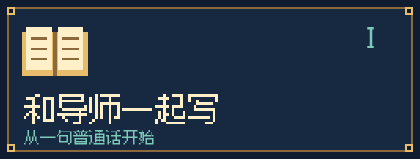
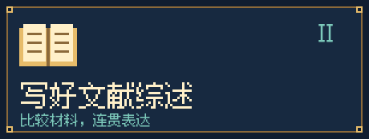

<p align="center">
  
</p>
<h1 align="center">从一个段落，写到一篇论文。</h1>

<p align="center">
  PAPER QUEST · 学术写作指南<br />
  改稿件、讲理由、练整篇。带上你的材料，或从虚构案例开始。
</p>

<p align="center">
  <a href="#try-demo"></a>
  &nbsp;
  <a href="https://github.com/NoNightWatch/EZ-to-write-a-paper/releases/latest/download/academic-manuscript-polish.zip"></a>
</p>
<p align="center">
  <a href="docs/guide.zh-CN.md">中文指南</a> ·
  <a href="README.en.md">English</a> ·
  <a href="docs/guide.en.md">English guide</a> ·
  <a href="academic-manuscript-polish/SKILL.md">执行指南</a> ·
  <a href="#quick-start">快速开始</a>
</p>
<p align="center"><strong>Codex · Claude Code · 可读取本地资料的 AI 助手</strong><br /><sub>v3.6.0 · 中英课程入口与练习册 · 完整英文范文 · 教学讲解主体为中文</sub></p>

<a id="try-demo"></a>


## 先看看，你会拿到什么

以下是原创虚构试用材料，没有真实研究数据。可先阅读示范；下载后让助手读取完整包，再用[试用请求](academic-manuscript-polish/assets/first-session-demo.md)体验。

**你给的段落**

> We interviewed 18 students about feedback timing. 12 of them said it was too late. We wanted to know their views.

**一版可用修订**

> We interviewed 18 students about their views on feedback timing. Twelve participants reported that the feedback arrived too late.

**你会读到的解释**：合并重复的目的表达；明确 `it` 指反馈；保留 18、12 和受访者陈述的身份，没有补写成绩影响。

接着可以说：“第一句恢复原句，第二句保留。英文改稿，中文解释。”这是参考示范，实际模型措辞可能不同。[先读取文件试用](docs/guide.zh-CN.md#try-without-install) · [按步骤安装](docs/guide.zh-CN.md#install)


## 你现在卡在哪里？

<table>
<tr>
<td width="50%" valign="top">

<h3>有东西想说，却不知道怎样写</h3>
<p>有稿件就直接修改；想从零学，可以用同一份虚构材料走完八阶段，读完整范文，自己尝试，再根据具体反馈重写。</p>
<p><a href="academic-manuscript-polish/references/first-paper-course.md">整篇课程</a> · <a href="academic-manuscript-polish/references/paper-workbook.zh-CN.md">中文练习册</a></p>
</td>
<td width="50%" valign="top">

<h3>读了很多文献，还是写成逐篇介绍</h3>
<p>围绕一个具体问题比较材料，把相同点、差异与适用范围组织进段落。先区分引言小段、学位论文章节和独立综述，再选择对应流程。</p>
<p><a href="academic-manuscript-polish/references/literature-review-mentor.md">综述导师</a> · <a href="academic-manuscript-polish/references/review-worked-example.md">完整练习</a></p>
</td>
</tr>
</table>

| 你的任务 | 可以直接这样说 | 本轮交付 |
| :--- | :--- | :--- |
| 已有初稿，只想改语言 | “保持内容，只改语法、表达和衔接。” | 修订文字与必要问题 |
| 不知道章节怎样展开 | “先帮我整理这节的顺序，再解释调整。” | 基于已有材料的结构与修订 |
| 跨学科词语容易混用 | “检查全文里的术语与缩写是否一致。” | 有上下文的术语核对 |
| 准备投某本期刊 | “按目标刊的当前作者指南检查这部分。” | 已核验要求、修改与未决项 |
| 想学会自己改 | “先示范一段，再给我一个可选练习。” | 修改、解释与练习参考 |
| 收到审稿意见 | “对应当前稿件逐条整理，区分已做和计划。” | 回应草稿、修改位置与待办 |

你可以随时说“直接给稿”或“讲细一点”。无需先学会写作分类，也无需填完一套表格。

### 第一次写整篇，从这里开始

**同一份材料，连续写成一篇文章。** 从六对虚构说明卡出发，整理事实、写问题和方法、核算结果，再完成引言、讨论、摘要与全文核对。可查看[完整英文范文](academic-manuscript-polish/references/paper-case-manuscript.md)，也可先做[中文练习](academic-manuscript-polish/references/paper-workbook.zh-CN.md)。

练习采用“尝试 → 定位问题 → 给提示 → 重写 → 换材料再试”。缺材料时会说明去哪里找、怎样问导师，以及哪部分可以先写。你可随时直接看答案。

> 请用整篇课程带我做 E01。先让我试，再给具体反馈，中文讲解。

[开始整篇课程](docs/guide.zh-CN.md#first-paper) · [看连续带写过程](academic-manuscript-polish/references/paper-case-walkthrough.md)

<sub>案例与数据均为虚构教学材料，不可作为真实研究投稿。课程尚未进行真实学生学习成效验证。</sub>

<a id="quick-start"></a>


## 三步开始，不必先填一套表

### 1. 下载完整文件夹

[直接下载指南 ZIP](https://github.com/NoNightWatch/EZ-to-write-a-paper/releases/latest/download/academic-manuscript-polish.zip) 并解压。打开其中的 `START-HERE.zh-CN.md` 或 `START-HERE.en.md`。保留完整文件夹；[版本记录](https://github.com/NoNightWatch/EZ-to-write-a-paper/releases)可查看旧版。GitHub 的 **Code → Download ZIP** 则会下载整个仓库。

### 2. 让助手读取启动页

把完整文件夹放在助手能读取的工作目录，告诉它：“读取 `academic-manuscript-polish/START-HERE.zh-CN.md`，按其中链接进入执行指南，处理虚构试用稿，不修改配置。”聊天界面不能读目录时，需要另行提供相关内容。

按使用环境选择读取方式：

| 使用环境 | 怎样开始 |
| :--- | :--- |
| Codex 或 Claude Code | 在指南所在的工作目录开始会话，提供启动页的实际位置 |
| 其他可读文件的助手 | 保持目录完整，请它读取启动页并访问相对链接 |
| 仅支持上传或粘贴的聊天界面 | 提供执行指南、当前所需资料和稿件片段，确认助手实际能读到 |

支持范围取决于宿主与组织设置。首次使用无需改动配置；[配置与排错](docs/guide.zh-CN.md#install)提供长期使用的方法。

### 3. 给它一个真实片段

```text
请使用 academic-manuscript-polish 修改下面这一段。
只改语言，保留数字、引用和原意。
英文修订，中文解释，先给干净稿。
［粘贴文字］
```

期刊未定也可开始。先确认助手读到了执行指南及相关资料，随后扩大范围。[已有旧版？查看更新方法](docs/guide.zh-CN.md#update)。


## 打开这间写作资料室


<sub>2,080 条记录含跨领域重复，英文词头字面去重为 2,043 项。基础覆盖与专业核验范围见下表；数量不代表效果评分。</sub>

| 资料 | 内容与入口 |
| :--- | :--- |
| **学科与术语** | [52 个入口](academic-manuscript-polish/references/discipline-map.md)，覆盖自然科学、工程与技术、医学与健康、农业科学、社会科学、人文与艺术，另含通用写作与统计表达 |
| **术语细读** | [基础词表](academic-manuscript-polish/references/foundation-index.md)及[九册详细词表](academic-manuscript-polish/references/glossary-index.md)，详细部分 308 条，含用法与边界 |
| **文章组织** | [十类写作路径](academic-manuscript-polish/references/writing-framework.md)，分别讲引言如何进入、主体如何排序、讨论如何组织已有解释 |
| **逐节写作** | [章节手册](academic-manuscript-polish/references/section-handbook.md)、[英语表达工具页](academic-manuscript-polish/references/language-toolkit.md)、12 个[修改示例](academic-manuscript-polish/references/worked-examples.md) |
| **边写边学** | [九节小课](academic-manuscript-polish/references/mentor-lessons.md)、[六组导师对话](academic-manuscript-polish/references/mentor-dialogues.md)、[52 个领域练习](academic-manuscript-polish/references/domain-practice.md) |
| **整篇带写** | [八阶段连续课程](academic-manuscript-polish/references/first-paper-course.md)、[完整英文稿](academic-manuscript-polish/references/paper-case-manuscript.md)、中英练习册、具体反馈、新材料练习与[材料缺口指导](academic-manuscript-polish/references/missing-materials.md) |
| **文献综述** | [阅读与综合流程](academic-manuscript-polish/references/literature-review-mentor.md)、[完整练习](academic-manuscript-polish/references/review-worked-example.md)、[四个跨学科练习](academic-manuscript-polish/references/review-transfer-cases.md) |
| **学科用词** | [208 组用词与搭配](academic-manuscript-polish/references/usage-selection.md)，覆盖 52 个入口，说明 `restructure`、`rebuild` 等词的适用对象与替换边界 |
| **期刊适配** | [40 份资料卡](academic-manuscript-polish/references/journal-cards.md)与[适配流程](academic-manuscript-polish/references/journal-adaptation.md)，区分文章类型、投稿阶段、刊方要求和样文观察 |
| **你的领域尚未覆盖** | 用[作者补充文献流程](academic-manuscript-polish/references/author-literature.md)建立本稿专用术语与体裁参考 |
| **修回与修改控制** | [逐条审稿回应](academic-manuscript-polish/references/reviewer-response.md)、[本轮控制](academic-manuscript-polish/references/session-controls.md)，保留作者决定与稿件对应 |

基础释义是工作用短释义，未逐条经外部专家核验。详细词条与基础词表有重合。模型应按当前稿件选择相关资料，正式定义回到原始文献或标准核对。

<details>
<summary><strong>展开：十类写作路径</strong></summary>

| 路径 | 适合的文字任务 |
| :--- | :--- |
| A · 概念、模型与形式证明 | 交代对象、定义与推导依赖 |
| B · 过程说明 | 按环节、位置或时间组织已有材料 |
| C · 比较研究 | 用相同指标讲清比较对象 |
| D · 问题逐项回应 | 让问题、结果与讨论一一对应 |
| E · 条件与时间展开 | 从总体结果展开不同阶段或条件 |
| F · 图谱与预测报告 | 交代覆盖范围、任务与原稿指标 |
| G · 方法与工具介绍 | 从具体使用任务进入已有表现 |
| H · 定义与测量比较 | 区分概念、指标与方法对应关系 |
| I · 历史、文本与情境叙事 | 按时序、主题或材料单元展开 |
| J · 文献综合 | 按问题与比较维度组织多篇文献 |

这些路径可以组合。它们服务于文字组织，专业理论与研究设计需要作者材料支持。

</details>


## 你可以改方向，也可以恢复原句

| 想要什么 | 直接说 |
| :--- | :--- |
| 先了解问题 | “只诊断，不动文件，指出最影响理解的两处。” |
| 保留自己的表达 | “只改必要语法，保留措辞和段落顺序。” |
| 看清变化 | “先给干净稿，再列关键改前改后。” |
| 局部恢复 | “第二句恢复原句，其他改动保留。” |
| 调整教学量 | “先示范再让我练”或“直接给答案”。 |

恢复需要可访问的原稿；纯文本比较不等于 Word 原生追踪修订。助手会区分必要修改和可选风格建议。

**贴近领域，保留你的声音**：根据实际样文调整句子节奏与信息衔接，保留清楚的长句，合并不必要的重复。短句和教材句型都按用途选择。[领域自然文风](docs/guide.zh-CN.md#field-style)

**收到审稿意见时**：逐条对照意见、作者实际修改与稿件位置。计划工作保留待办状态，正式回应中的“已修改”需要当前材料支持。[修回使用方法](docs/guide.zh-CN.md#reviewer-response)


## 每次修改都有清楚的范围

| 阶段 | 助手处理什么 | 你能检查什么 |
| :--- | :--- | :--- |
| 读材料 | 确认实际能读到的内容和本轮任务 | 哪些部分已读，哪些不可读 |
| 找资料 | 按需匹配学科词表、章节与期刊规则 | 用了哪些资料，哪些要求待核验 |
| 做修改 | 在约定幅度内修改语言或组织 | 修订稿与原文的对应 |
| 讲理由 | 解释最重要的几处，可附练习 | 为什么改、保留了什么 |
| 做核对 | 复核数字、单位、引用、术语和可见格式 | 已完成部分与仍需作者处理的事项 |

综述任务会额外记录实际阅读范围，先核对每项主张的来源，再组织综合段落。长稿可分批推进；需要续接时可生成一张进度卡，保存须由作者提出。


## 出发前，先知道这些

<details>
<summary><strong>没有完整稿件，也没选期刊，可以用吗？</strong></summary>

可以。先给已有笔记、提纲或一个段落。期刊未定时做通用修改。只有选题、没有实质材料时，先整理问题和材料清单，不生成研究事实。

</details>

<details>
<summary><strong>我的学科不在目录里，怎么办？</strong></summary>

提供与你的稿件相近的文献或术语定义，并说明希望参考什么。助手会记录来源与适用范围，建立仅供当前稿件使用的资料。几篇样文不能代表整个学科或期刊。

</details>

<details>
<summary><strong>能帮我写文献综述吗？</strong></summary>

可以从你实际提供的材料开始，帮助比较、组织与表达。只有摘要时会标明读取层级。未完成检索、筛选和相应方法流程的材料，不应被命名为系统综述。详见[综述使用指南](docs/guide.zh-CN.md#review)。

</details>

<details>
<summary><strong>整包都是中英双语吗？</strong></summary>

首页和用户指南提供完整中英两版；术语包含中英对应。导师教材与大部分内部说明以中文为主。使用时可要求助手用英文修订和解释，本仓库未声称全部教材已逐页译成英文。

</details>

<details>
<summary><strong>需要 Python 吗？能离线使用吗？</strong></summary>

阅读教材和让助手按流程编辑无需运行脚本。离线查词与校验工具需要 Python 3.9+，只用标准库。AI 助手是否联网、如何处理稿件，由你使用的宿主和账户设置决定；本地存放指南包不意味着模型在本地运行。

</details>

<details>
<summary><strong>会自动上传稿件、投稿或改动我的原文件吗？</strong></summary>

指南指令要求保留原稿，未经明确要求不发布、投稿或把稿件写入共享包。请检查宿主权限、机构保密要求和目标期刊的 AI 使用政策，再提供未发表材料。不要把私人稿件贴到本仓库的公开 Issue 中。

</details>

**写作边界**：保留作者事实与研究判断，不编造数据、引用、机制或伦理信息，不保证录用。期刊偏好要有来源；当前官方作者指南优先。医学内容限于阅读与学术表达，危险操作细节不由本包补全。

**检查范围**：86 项包内测试、9 项中英页面测试通过，覆盖结构、检索、教学数据与语言入口。未开展独立模型评估或真实学生教学实验。查看[本轮课程检查](academic-manuscript-polish/tests/paper-course-audit.md)、[用词及期刊检查](academic-manuscript-polish/tests/usage-journal-audit.md)与[资料来源](academic-manuscript-polish/references/sources.md)。

<details>
<summary><strong>展开：目录与可选本地命令</strong></summary>

```text
academic-manuscript-polish/
  START-HERE.zh-CN.md     中文启动页
  START-HERE.en.md        英文启动页
  references/            术语、教程、期刊与写作资料
  assets/                可选任务卡与交付模板
  agents/                宿主显示元数据
  scripts/               查词与结构校验
  tests/                 自动测试与检查记录
  bundle-manifest.json   版本与内容清单
```

在指南文件夹内运行：

```sh
python scripts/search_terms.py "validity" --exact --format text
python scripts/search_terms.py --list-domains
python scripts/validate_bundle.py
python -B tests/test_bundle.py
```

</details>

<p align="center"></p>
<p align="center"><strong>准备一个段落，选一个小目标，然后开始。</strong></p>
<p align="center"><a href="docs/guide.zh-CN.md">阅读中文指南</a> · <a href="docs/guide.en.md">English guide</a> · <a href="https://github.com/NoNightWatch/EZ-to-write-a-paper/releases/latest/download/academic-manuscript-polish.zip">直接下载指南包</a></p>
<p align="center"><sub>觉得有用，可以点击 Star 收藏。发现问题，欢迎提交不含私人稿件的 <a href="https://github.com/NoNightWatch/EZ-to-write-a-paper/issues">问题反馈</a>。</sub></p>
